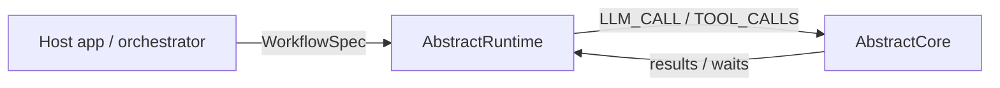

# AbstractRuntime

**Release 0.19.3:** turning an entity's own time off is final: the turn in flight finishes whole, then nothing runs,
and the day's look-back waits for the next opening. Requires AbstractCore 2.35.0 and AbstractMemory 0.5.1. See
[release notes](CHANGELOG.md).

**AbstractRuntime** is a durable workflow runtime (interrupt → checkpoint → resume) with an append-only execution ledger.

It is designed for long-running workflows that must survive restarts and explicitly model blocking (human input, timers, external events, subworkflows) without keeping Python stacks alive.

**Version:** 0.19.3 • **Python:** 3.10+

**Status:** pre-1.0 (API may evolve). For production use, pin versions and follow `CHANGELOG.md`.

## What's new in 0.19.3

- **Own time withdrawn ends on the turn in flight.** When the operator turns an entity's own time off, the turn in
  flight finishes whole, then nothing runs: no tick look-back, no authoring drain, no day look-back. A look-back
  whose model call is running at the revoke keeps nothing of its reply. The day's look-back is not lost:
  `pending_reflection.json` carries it to the next opening (a visit, the next own-time day). "Withdrawn" means the
  operator's stop (the stop command, the STOP file, the kill switch) or, on a personal day, the grant revoked or
  expired; a work day responds only to a stop. A normal close (rest, the day's last tick) still runs its look-back.

No new floors (AbstractCore 2.35.0, AbstractMemory 0.5.1).

## What's new in 0.19.2

- **Three visit ledger fields for a live view of the turn** (what the Entity app's live activity panel shows; all
  additive, a reader without them shows what it showed before): `topic` on every recalled memory of a
  `memory_recall` record (the key of the topic it is in now, or null), `iteration` and `max_iterations` on the
  `reason` model-call record ("step 2 of 50"), and `hits` on a `search_memory` result. None of them reaches the
  model's prompt. See [docs/entity-runtime.md](docs/entity-runtime.md).
- **The topic stamp is a membership-only read**: one `community_keys_of` call per recall (AbstractMemory 0.5.1,
  re-exported by the memory facade) with the recalled memories' ids, answered from memory's in-process community
  index. About 50 µs for 44 memories at 2,000 and at 20,000 records on a synthetic home; the first call in a process
  loads the index once (tens of ms). It never reads the whole topics payload, which grows with the home. A lookup
  that fails leaves the recall whole and says why in its warnings.
- **Plain loop notes**: an entity's own time that stopped because its process is gone now reads "His own time
  stopped without a word (the process is gone: a crash or a reboot). His memory is intact."; one stopped after three
  failed ticks reads "Stopped after three failed ticks: <the last failure>. His memory is intact."

Upgrade note: requires AbstractMemory 0.5.1 or newer (new floor; AbstractCore stays at 2.35.0).

## What's new in 0.19.1

- **The entity's self-knowledge brief**: at the end of each sleep's topics stage the entity's summaries model writes
  a brief (at most 400 tokens) of its topics and the trails of thought between them, stored in `<home>/self_brief.md`.
  Every lane (hosted chat, own time, work, visits) places it right after the identity block of the system prompt, so
  the cached prefix changes at most once per sleep. A sleep whose topics did not change makes no call; a failure keeps
  the previous brief. See [docs/entity-topics.md](docs/entity-topics.md).
- The `topics` tool description stays within AbstractCore's 200-character limit.

No new dependency floor: AbstractCore 2.35.0 and AbstractMemory 0.5.0, as in 0.19.0.

## What's new in 0.19.0

- **An unreachable model endpoint parks the run**: when AbstractCore raises `EndpointUnreachableError` (the machine
  serving the model is off, asleep or unreachable), the LLM call becomes a durable wait on that endpoint and the run
  continues from the same node once it answers, instead of failing.
- **An entity's cognition profile**: a home's `cognition.yaml` names a model per part of its thinking (`summaries`,
  `understanding`, `extraction`), how many memories a turn brings to mind, how readily it revisits what it
  understood, what its look-back sees, and the sleep thresholds of an idle entity. See
  [docs/entity-runtime.md](docs/entity-runtime.md).
- **The five-state life cycle** (phase spec v25): visit, idle, work, personal and sleep, plus stopped. Work starts
  when a job is queued (there is no work toggle), own time needs the operator's grant, turning personal time off
  leaves the entity awake, and no clock drives a sleep.
- **A Stop is final**: every state write of an entity's runtime carries a `LifecycleFence`. After the operator's
  Stop no model call starts and no diary, artifact, memory or status write lands, in any process.
- **Every memory's title and summary are authored**: the `summaries` model writes them with the record; when that
  fails, the record is pending and the sleep's repair authors it, records stored before included. Stored text is
  never cut.
- **Topics**: the night forms the entity's topics from AbstractMemory's community records, and its `topics` tool
  lists and searches them. See [docs/entity-topics.md](docs/entity-topics.md).
- **Default iteration budget 50**, one exported constant (`DEFAULT_MAX_ITERATIONS`), and the requested budget is the
  one the agent obeys.
- **Who spoke**: session turns, replayed history and the replay view carry the turn's `author`; an unsigned entity
  stamp never makes a turn an entity's.
- **Tool results and visit images**: every tool result during entity activity is kept whole as an artifact of the
  home, and an image attached in a visit reaches the entity's model as an image.

Upgrade notes:

- Requires AbstractCore 2.35.0 and AbstractMemory 0.5.0 or newer (both are dependency floors).
- Hosts that open entity homes pass the fence: `open_home(..., fence=)`, `open_entity_runtime(..., fence=)`,
  `ChatSession(..., fence=)` (it replaces `cancel_check`), `spawn_loop_process(..., fence=)` and
  `build_consolidator(..., fence=)` take it keyword-only, with no default. A `DiaryStore` or `FileArtifactStore`
  given a callable guard also takes `barrier_home=`.
- A host that serves skill files registers its skill roots once per process with `register_skill_roots([...])`;
  a folder outside a registered root is not served.
- `identity.communities.memory_communities` raises `CommunitiesRetired`; serve `memory_facade.communities` instead.

Full list: [CHANGELOG.md](CHANGELOG.md).

## What's new in 0.18.4

An entity's own time, its sleep narrator and the command-line visit now wait at least 1800 seconds before timing out,
instead of 120. A lower `ABSTRACTRUNTIME_ENTITY_LLM_TIMEOUT_S` is raised to 1800 (`0` still means no timeout), and
the retry budget is never shorter than one call.

## What's new in 0.18.3

Listing text-to-speech models when the voice engine cannot run now gives AbstractVoice's own reason in
plain words (for example that the engine is not installed or no API key is set) instead of a bare Python error.

## What's new in 0.18.2

An embedding import failure now reports its real cause (for example a missing dependency) instead of a
secondary error from a fallback import path.

## What's new in 0.18.1

- **A public update names the identity its run started with**: the replay view copies the run's `identity_ref` onto
  its public updates, so a host serving cached views shows who spoke; a run without one gets no field.

## What's new in 0.18.0

- **Models unload after being idle**: a host sets how long a local model may sit unused (`set_model_idle_unload`,
  AbstractCore's default 60 minutes; off with `None` or `0`); a running call is never interrupted and a model kept
  loaded never unloads. `set_model_residency_locks` relays the host's "Keep loaded" set, and both come back after a
  model-host restart. Loaded-model rows say when a model was last used, whether it is in use, who keeps it loaded
  and when it unloads. Requires AbstractCore 2.34.0 or newer.
- **A failed tool keeps its explanation**: a tool that reports its failure as a JSON object (a web search's backends,
  bot-challenge status and hint) keeps it in the result, the run ledger and what the visual-flow Agent node shows
  the model, after the error line.
- **A store that cannot attribute a session is refused**: a custom run store whose index rows lack `session_kind`
  no longer lets a discussion start as a plain chat; it raises `SessionAttributionError` naming what to add.
- **An entity has a recorded look and voice**: one record in its home holds its avatar and its voice, with a default
  from birth and every change remembered (the entity is told when its look or voice changed). See
  [docs/digital-identity.md](docs/digital-identity.md).
- **An entity has a track record and a first reputation**: both are computed from what it has done (runs, outcomes,
  tokens per kind of task); until feedback from people and agents exists, the reputation is the completion rate
  only. See [docs/track-record.md](docs/track-record.md).
- **An entity knows its acquaintances**: the entities and people it has interacted with are listed from its own
  records, with when they first and last met. See [docs/track-record.md](docs/track-record.md#acquaintances). Full
  list: [CHANGELOG.md](CHANGELOG.md).

## What's new in 0.17.0

- **A host stop suspends a run, it never fails it**: a host that stops on purpose raises `EffectInterrupted` into
  the effect in flight; the runtime writes no terminal record, the run stays running at its last durable step, and
  the next tick sends the call again as attempt 1 (no retry used, no automation outcome, nothing notified).
- **Public updates are typed**: a `public_update` in the replay view carries `update_kind`, `"finding"` (a fact or
  piece of evidence the actor established) or `"progress"` (what it is doing), so a client can list a conversation's
  findings. See [docs/replay.md](docs/replay.md#public-conversation-messages).
- **Replayed tool calls keep the model's call id**: an `activities[].tool_calls[]` row also carries `call_id`, the id
  a public update's `source_call_ids` cite, so a finding resolves to the results it cites.
- **Compare reads text next to a number or true/false exactly**: `5 == "5"` and `"9" < 10` are true, text it
  cannot read as that type (`"five"`, `"0x10"`, empty) fails the step with an error naming the node and pins, and
  text against text is never converted.
- **An automation occurrence says why it failed**: when the agent finished without success, the attention item and
  the notification carry the agent's own error, never "completed". Full list: [CHANGELOG.md](CHANGELOG.md).

## What's new in 0.16.0

- **Calibrated decisions**: an `LLM_CALL` whose output says `modality: "decision"` returns typed answers
  (`answers`, `decision`) from a decision model instead of generated text; `run_facade.decide(...)` runs one as a
  durable child run and the `decide` VisualFlow node asks a choice, yes/no or score question. Requires AbstractCore
  2.32.0 or newer (AbstractRuntime 0.18.0 requires 2.34.0). See [docs/integrations/abstractcore.md](docs/integrations/abstractcore.md).
- **Conversational questions and guidance**: `ASK_USER` can ask an essential question (waits indefinitely) or a timed
  clarification with a declared fallback; `Runtime.steer(..., display_text=)` records human guidance in its exact
  words; opt-in public updates and tool-approval `public_action` context appear in the replay view.
- **Model residency in words**: fit refusals are never retried and keep their typed fields on the ledger, residency
  rows carry the slot pool (`slots`, `active`, `queued`, ...) and name who holds a model, and the config facade reads
  and sets a local model's loaded context (`configured_model_context`, `set_model_context`).
- **Structured output across process boundaries**: JSON schemas travel as data and validators are built where
  inference runs, for local, remote and hybrid clients alike.
- **Voice transport is not a turn attachment** in history bundles and conversation search. Full list:
  [CHANGELOG.md](CHANGELOG.md#0160---2026-11-02).

## What's new in 0.15.3

- **A run-store index build no longer announces its journal replay as changes**: a plain read (`list_run_index`,
  `warm_session_index`) leaves `change_token` and `changed_run_ids` untouched, so a change-driven consumer (the
  gateway's mail notification check) no longer re-reads every finished run after each build (a 0.15.2 regression;
  AbstractGateway backlog 0965). A file that landed during the build and a known run that vanished are still announced.

## What's new in 0.15.2

- **Run index builds never lose a run created during them**: a run another process (or store object) wrote while
  this store built its indexes is in the session and children indexes and the listing at once (before, the session
  index could miss it for the life of the store object; backlog 0863).

## What's new in 0.15.1

- **Is Empty accepts lists**: nothing, an empty text, or a list or object with no elements is empty (visual-flow
  node `is_empty_string`; backlog 0862).

## What's new in 0.15.0

- **Memory facade** (`abstractruntime.integrations.abstractmemory.memory_facade.MemoryFacade`): the one
  host surface for AbstractMemory 0.4.0's memory graph (open a mind, stamp provenance, reconstruct a
  source, history, revisions); hosts no longer import `abstractmemory`. ADR 0011. See
  [docs/integrations/abstractmemory.md](docs/integrations/abstractmemory.md).
- **`MEMORY_REVISE`** effect and `memory_revise` VisualFlow node: one atomic revision of a mind
  (assert / close / narrow) as a workflow step, stamped with the step that applied it.
- **Ledger provenance**: `LedgerStore.get_record(run_id, seq)` point reads, a step context for
  effect handlers, and a digested `step` / `artifact` / `diary_entry` source ref on every memory
  write the runtime performs (`reconstruct_source` answers `ok`, `partial`, `mismatch`,
  `source_gone` or `unsupported`).
- Upgrade note: requires AbstractMemory 0.4.0, whose vector re-encoding is one-way; move every
  process sharing a memory home together.

## What's new in 0.14.0

- **Replay view** (`abstractruntime.replay`): one deterministic reducer turns a run tree's ledger
  into the view every client renders (status, the interaction to answer, messages, activities,
  artifacts), with incremental deltas. Every ledger store now numbers records with a durable
  per-run `seq` cursor (`list_after`). See [docs/replay.md](docs/replay.md).
- **Session tool policy**: a conversation's standing approve/deny is applied before any approval
  wait, with an `abstract.tool_policy_decision` audit record. See
  [docs/tool-approval.md](docs/tool-approval.md#session-tool-policy-a-conversations-standing-word).
- Upgrade note: hash-chained JSONL ledgers written by 0.14.0 fail an older `verify_ledger_chain`;
  upgrade writers and verifiers together.

## AbstractFramework ecosystem

AbstractRuntime is one component of the wider [AbstractFramework](https://github.com/lpalbou/AbstractFramework) ecosystem:
- **AbstractRuntime** (this repo) — durable workflow kernel (`src/abstractruntime/core/*`)
- **AbstractCore** — LLM + tools integration (wired via `src/abstractruntime/integrations/abstractcore/*`)  
  Repo: [lpalbou/abstractcore](https://github.com/lpalbou/abstractcore)

At a high level, hosts define workflow graphs (`WorkflowSpec`) and AbstractRuntime executes them durably. When nodes request LLM/tool work (`EffectType.LLM_CALL`, `EffectType.TOOL_CALLS`), those effects are typically handled via AbstractCore.



## Install

Remote-light runtime:

```bash
pip install abstractruntime
```

The base install includes AbstractCore 2.35.0 or newer (its light install:
remote providers, tools, vision, voice, audio, music, and decision integration) and AbstractMemory 0.5.1 or
newer, plus the
`abstractruntime-mcp-worker` entry point. It keeps inference remote/light by
default: local engines such as MLX, vLLM, HuggingFace/Torch, Diffusers, and
sentence-transformer embeddings are not selected unless you choose a hardware
profile or another package-specific local extra.

VisualFlow document nodes use permissive dependencies in Runtime's base install:
`Read PDF` extracts text and metadata with `pypdf`, `Write PDF` renders text or
Markdown-style report content to real PDF bytes with `reportlab`, and
`Write DOCX` renders Markdown-style report content to Word-compatible `.docx`
bytes with the Python standard library.

Native Python hardware profiles add local inferencer stacks:

```bash
pip install "abstractruntime[apple]"
pip install "abstractruntime[gpu]"
```

`abstractruntime[apple]` delegates to AbstractCore's native Apple aggregate;
`abstractruntime[gpu]` delegates to AbstractCore's GPU aggregate.

## Quick start (pause + resume)

```python
from abstractruntime import Effect, EffectType, Runtime, StepPlan, WorkflowSpec
from abstractruntime.storage import InMemoryLedgerStore, InMemoryRunStore


def ask(run, ctx):
    return StepPlan(
        node_id="ask",
        effect=Effect(
            type=EffectType.ASK_USER,
            payload={"prompt": "Continue?"},
            result_key="user_answer",
        ),
        next_node="done",
    )


def done(run, ctx):
    answer = run.vars.get("user_answer") or {}
    text = answer.get("text") if isinstance(answer, dict) else None
    return StepPlan(node_id="done", complete_output={"answer": text})


wf = WorkflowSpec(workflow_id="demo", entry_node="ask", nodes={"ask": ask, "done": done})
rt = Runtime(run_store=InMemoryRunStore(), ledger_store=InMemoryLedgerStore())

run_id = rt.start(workflow=wf)
state = rt.tick(workflow=wf, run_id=run_id)
assert state.status.value == "waiting"

state = rt.resume(
    workflow=wf,
    run_id=run_id,
    wait_key=state.waiting.wait_key,
    payload={"text": "yes"},
)
assert state.status.value == "completed"
```

## What’s included (v0.8.2)

Kernel (import-light):
- workflow graphs: `WorkflowSpec` (`src/abstractruntime/core/spec.py`)
- durable execution: `Runtime.start/tick/resume` (`src/abstractruntime/core/runtime.py`)
- durable waits/events: `WAIT_EVENT`, `WAIT_UNTIL`, `ASK_USER`, `EMIT_EVENT`
- append-only ledger (`StepRecord`) + node traces (`vars["_runtime"]["node_traces"]`)
- retries/idempotency hooks: `src/abstractruntime/core/policy.py`
- runtime-aware limits (`_limits`) with a default iteration budget of 20 (`docs/limits.md`)
- Stop that reaches the running effect: `Runtime.cancel_run(...)` signals the in-flight model or tool call, which ends as a `cancelled` ledger record (never retried); a model unload stops the calls using that model first (`docs/api.md`)
- host pause at step boundaries: `Runtime.tick(..., step_gate=...)`
- run-tree tool ceiling: an explicit `allowed_tools` list can only narrow across child runs, and approval policy never widens it
- automations: run a workflow on a schedule (`schedule@1` fixed UTC intervals; `schedule@2` adds daily, weekly and monthly rules at a wall time in an IANA time zone), when mail arrives in one of the user's mailboxes (`email.received@1`, `docs/email.md`), on new feed items (`feed.item@1`), on a signed webhook call (`webhook.received@1`) or on request (`manual@1`) as a durable controller run; per-user trigger connections (feed URLs, webhook endpoints with sealed signing secrets) reused by any automation; every occurrence receives its trigger as a CloudEvents 1.0 event (`input_data.event`) and records who or what started it (`_meta.origin`); runs can schedule work for later with `SCHEDULE_RUN` (a one-shot wake in the same session, at most the caller's tools, reminders that reach the person), whose occurrences are deterministic child runs and session turns, with commands, independent or growing context, discussions forked at any occurrence (own workspace, automation workspace mounted read-only), tool approval, typed waits and quiet-by-default notifications (`docs/automations.md`)
- flows that act and tell: mail verbs on the run's mailbox (`mail_search`, `mail_get`, `mail_mark`, `mail_label`, `mail_move`, `mail_delete`, `mail_send`, `mail_reply`, `mail_forward`, `mail_attachment`; changes and sends only on a mailbox the person keeps Read and write, `docs/email.md`) and Publish to channel (`PUBLISH_EVENT`: an event on the user's stream, optionally an alert with its `recipient` and `channels`, handed to the host through `Runtime.set_publish_event_handler`, `docs/automations.md`)
- explicit run ids: `Runtime.start(..., run_id=...)` creates a run only if the id is free (`RunStore.create_if_absent`), and `run_mutation_lock(run_id)` serializes a run's writers in a process

Durability + storage:
- stores: in-memory, JSON/JSONL, SQLite (`src/abstractruntime/storage/*`)
- durable command inbox primitives (idempotent, append-only): `CommandStore`, `CommandCursorStore` (`src/abstractruntime/storage/commands.py`, `src/abstractruntime/storage/sqlite.py`)
- artifacts + offloading (store large payloads by reference)
- large JSON run folders without scans: an in-memory active index and trusted run index (`trust_index`, `run_index_stats()`, background reconciliation), change tokens on the run store and the ledger (`change_token()`, `changed_run_ids()`), event-wait indexes that see another process's parked runs, and the active-consumers index for "who listens?" (`docs/architecture.md`, `docs/api.md`)
- snapshots/bookmarks (`docs/snapshots.md`)
- tamper-evident hash-chained ledger (`docs/provenance.md`)

Drivers + distribution:
- scheduler: `create_scheduled_runtime()` (`src/abstractruntime/scheduler/*`)
- VisualFlow compiler + WorkflowBundles (`src/abstractruntime/visualflow_compiler/*`, `src/abstractruntime/workflow_bundle/*`)
- VisualFlow multi-entry execution lowering for fan-in routes and per-entry input overrides (`docs/workflow-bundles.md`)
- VisualFlow LLM Call and Agent nodes propagate Core generation params such as
  `thinking` and `speculation` through Runtime effects; `_runtime.speculation`
  sets a run-wide MTP preference that nested workflows and Agent loops inherit. Provider Models nodes can apply Core
  `capability_route` filters so run-time model discovery matches Gateway/Flow
  authoring.
- VisualFlow image/video nodes and Runtime media helpers preserve task-specific
  Core media controls, including `count`/`n`, `seeds`, ordered
  `lora_adapters`, and video `flow_shift`, while keeping provider/model/task
  truth in AbstractCore and AbstractVision.
- `history_bundle` exports replay-safe `resolved_actions` summaries derived
  from Core request/output route resolution, so thin clients can reconstruct
  what capability ran without reverse-engineering prompt prose.
- VisualFlow structured LLM/Agent results preserve `response` as text and expose
  the schema-conformant object on `data`, so Break Object and Switch can consume
  fields without reparsing the response string.
- run history export: `export_run_history_bundle(...)` (`src/abstractruntime/history_bundle.py`)

Runtime-owned integrations:
- AbstractCore (LLM + tools, `MODEL_RESIDENCY` with residency locks and context estimates, public discovery/host/run facades, cached sessions with per-session prompt-cache listing/clearing, host memory snapshots, local-only prompt-cache export/import admin, durable bloc prompt-cache controls, bindings, lifecycle operations, generated image/video/voice/music outputs with progress events, calibrated decisions (`decide`), host email helpers, Telegram host wrappers, and tool approval waits): `docs/integrations/abstractcore.md`
- AbstractCore models and engines for hosts: `config_facade` passes through the host profile, local-engine status and installs, the model catalog with fit verdicts, installed models, deletes, host jobs (with who-cancelled attribution) and the embeddable console screens: `docs/integrations/abstractcore.md#models-engines-and-host-jobs-config-facade`
- For outbound comms, use the durable run facade when the send belongs to a run: `get_abstractcore_run_facade(...).send_email(...)` / `send_telegram_message(...)`. If that child run pauses for approval or passthrough execution, resume it through `resume_tool_calls(...)`. Direct host-facade send helpers and the standalone email comms facade remain host-local and nondurable.
- AbstractMemory TripleStore integration for `MEMORY_KG_*` effects. Runtime
  depends on the light AbstractMemory contract; hosts choose storage backends
  such as LanceDB, SQLite, or in-memory stores.
- comms toolset gating (email/WhatsApp/Telegram): `docs/tools-comms.md`
- live token streaming: `Runtime.set_live_delta_sink(sink)` plus `_runtime.stream: true` delivers `llm.delta` / `llm.delta_end` events while an answer is generated, outside the ledger (`docs/integrations/abstractcore.md#live-token-streaming`)
- model switching in a shared process: changing the default model unloads the previous in-process model unless another owner in the process still uses it (`docs/integrations/abstractcore.md#unloading-and-switching-models`)
- workspace-scoped file and shell tools driven by `workspace_*` run vars, including host-only protected folders that are enforced without being shown to the model (`docs/integrations/abstractcore.md#workspace-scoped-tools`)

## Built-in scheduler (zero-config)

```python
from abstractruntime import create_scheduled_runtime

sr = create_scheduled_runtime()
run_id, state = sr.run(my_workflow)

if state.status.value == "waiting":
    state = sr.respond(run_id, {"text": "yes"})

sr.stop()
```

For persistent storage:

```python
from abstractruntime import create_scheduled_runtime, JsonFileRunStore, JsonlLedgerStore

sr = create_scheduled_runtime(
    run_store=JsonFileRunStore("./data"),
    ledger_store=JsonlLedgerStore("./data"),
)
```

## For AI agents

Register and use the [`abstractruntime` agent skill](https://github.com/lpalbou/AbstractRuntime/tree/main/skills/abstractruntime)
to operate durable workflows, waits, storage and AbstractCore integration. Copy
`skills/abstractruntime/` from the checkout matching your package version into
your agent's skills directory. Start with its install verification, then use the
linked documentation for the installed version.

## Documentation

| Document | Description |
|----------|-------------|
| [Getting Started](docs/getting-started.md) | Install + first durable workflow |
| [API Reference](docs/api.md) | Public API surface (imports + pointers) |
| [Docs Index](docs/README.md) | Full docs map (guides + reference) |
| [FAQ](docs/faq.md) | Common questions and gotchas |
| [Troubleshooting](docs/troubleshooting.md) | Symptom-oriented setup, runtime, and integration fixes |
| [Architecture](docs/architecture.md) | Component map + diagrams |
| [Overview](docs/proposal.md) | Design goals, core concepts, and scope |
| [AbstractCore Integration](docs/integrations/abstractcore.md) | `LLM_CALL` / `TOOL_CALLS`, host facades, models/engines/host jobs |
| [Automations](docs/automations.md) | Scheduled, event-driven and on-request workflows: controller, triggers (schedules, mail, feeds in RSS 2.0/RSS 1.0/Atom, webhooks), trigger connections, the CloudEvents envelope, run origin, wakes (`SCHEDULE_RUN`), Publish to channel (alerts with `recipient` and `channels`), commands, context, discussions, storage guarantees |
| [Email](docs/email.md) | Email for each user: run-scoped account binding, sending without asking, the event inbox and mail feeder, the `email.received@1` trigger on any of the user's mailboxes, mail verbs for flows (Read only / Read and write), the send-email action |
| [Artifacts](docs/artifacts.md) | Artifact identity, descriptors, catalog search and access stats |
| [Tool Approval](docs/tool-approval.md) | Tool risk tiers, run-policy ceiling, per-call refiners |
| [Comms Toolset](docs/tools-comms.md) | Opt-in email/WhatsApp/Telegram tools |
| [Entity Runtime](docs/entity-runtime.md) | Per-entity runtimes, homes, leases, visit waits |
| [Snapshots](docs/snapshots.md) | Named checkpoints for run state |
| [Provenance](docs/provenance.md) | Tamper-evident ledger documentation |
| [Evidence](docs/evidence.md) | Artifact-backed evidence capture for web/command tools |
| [Limits](docs/limits.md) | `_limits` namespace and RuntimeConfig |
| [WorkflowBundles](docs/workflow-bundles.md) | `.flow` bundle format (VisualFlow distribution) |
| [MCP Worker](docs/mcp-worker.md) | `abstractruntime-mcp-worker` CLI |
| [Changelog](CHANGELOG.md) | Release notes |
| [Contributing](CONTRIBUTING.md) | How to build/test and submit changes |
| [Code of Conduct](CODE_OF_CONDUCT.md) | Contributor conduct expectations |
| [Security](SECURITY.md) | Responsible vulnerability reporting |
| [Acknowledgments](ACKNOWLEDGMENTS.md) | Credits |
| [ROADMAP](ROADMAP.md) | Current status and longer-term direction |

## Development

```bash
python -m venv .venv
source .venv/bin/activate
python -m pip install -U pip
python -m pip install -e ".[test,docs]"
python -m pytest -q
```

See `CONTRIBUTING.md` for contribution guidelines and doc conventions.
