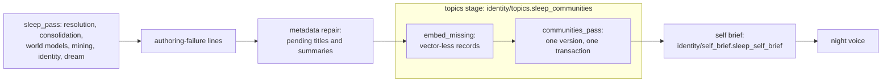

# Entity topics (memory communities)

An entity's **topics** are its memories grouped by subject. Each topic has a title and a summary written by a model,
and the grouping forms again at every sleep. They let the entity see what it knows, organized, and go deeper into
one part of its memory.

AbstractMemory owns the topics: it forms the `community` records (detection over the memory graph, stable keys across
versions, authored titles, layout) and serves them. AbstractRuntime holds no community code. It runs the forming
during the entity's sleep, writes the entity's at-a-glance brief of its topics into its system prompt, gives the
entity a tool to read its topics, and exposes memory's topic verbs to hosts.

Related pages: [Entity runtime](entity-runtime.md) (homes, the cognition profile, the idle-sleep thresholds) and
[AbstractMemory integration](integrations/abstractmemory.md) (the memory facade hosts import).

## When topics form: the night's topics stage

The own-time loop's sleep runs its maintenance in a fixed order (`life.build_consolidator`). The topics stage comes
after the metadata repair and before the night voice:



- **Every sleep runs it**, unless the night already ended before it: a visitor at the door, a wake, a pause or the
  STOP brake end the night at its next stage. The receipt then says
  `{"skipped": "the night ended before the topics step"}`.
- **Embedding comes first.** Memory embeds every open record of the entity's scopes that has no vector yet
  (`embed_missing`, with the night's embedding model, the loop's `--embedding-model`), so the pass's
  nearest-neighbour edges see them. When records cannot be embedded (no embedding model, an unreachable one), the
  night writes one note, and memory places those records by their engraved neighbours.
- **One version per sleep.** `communities_pass` forms the night's version in one guarded transaction. A sleep that
  changes no membership writes nothing (`skipped: "unchanged: ..."`).
- **Titles are authored.** The summaries capability writes each changed topic's title and summary
  (`capabilities.summaries` in the [cognition profile](entity-runtime.md#cognition-profile-identitycognition_profilepy)),
  the same author that titles every record the night forms. The pass gets what the metadata repair left of the
  night's authoring budget (`authoring_cap`, 64 model calls by default, minus the tasks the repair took). The repair
  runs within the cap minus a reserved quarter (`TOPICS_AUTHORING_SHARE`, 16 calls of 64), so a home with hundreds of
  fields to repair still has its topics titled the same night. Topics past
  that budget form *pending*, with their authoring tasks, and the drainer writes their titles at a later authoring
  window. A title the model could not write gets its authoring-failure line.
- **It is fenced.** Both memory calls run with `cancelled=fence.moved`, the author is checked before every model call,
  and memory's commit guard refuses the version after the operator's Stop. A stopped night records nothing for its
  topics: no version, no log line, no maintenance note. The receipt says `stopped`.

What the night records:

| Where | What |
|---|---|
| the night's result, `communities` | memory's receipt (`version_seq`, `communities`, `new`, `kept`, `renamed`, `dissolved`, `authored`, `titles_kept`, `pending`, `failed`, `unvectored_count`, `unplaced_count`, `unplaced_closed`, `skipped`, `cancelled`, `timings_ms` with its detection `rounds`, `budget`: the calls the pass was given, `budget_spent`: the author calls it made) plus `embedding: {embedded, skipped, failed}` |
| `own_time.log` | one line per sleep, for example `(topics: version 1287 - 14 topics: 2 new, 12 kept, 0 dissolved, 3 retitled, 41 memories moved; titles 5 authored, 9 kept, 0 pending, 0 failed; authoring budget 16 calls, 5 spent; 136 embedded first, 0 without a vector, 2 unplaced (2 with only closed neighbours); 3 detection rounds)`, or `(topics: no new version - unchanged: every community stands as it is; ...)` |
| memq_maintenance (memory's completed-maintenance row of that night) | `detail.communities_version`: the `version_seq` the night wrote |
| the authoring-failures file | one line per topic whose title could not be authored (`template_id` `memory.communities_pass`) |

A memory without the topic verbs produces one `#MISSING_VERB abstractmemory.embed_missing / communities_pass` line
per sleep and the receipt `{"missing_verb": ...}`. The rest of the night stands.

A host that runs its own sleep can run the same stage:

```python
from abstractruntime.identity.topics import sleep_communities

receipt = sleep_communities(
    home.ms, entity_id=eid, scopes=[("self", eid), ("diary", eid), ("life", eid)],
    author=formation_author,          # memory's author(kind, body, context) callable
    fence=fence,                      # the LifecycleFence the sleep was admitted at
    budget=None,                      # most author calls; None = no bound
    maintenance_kind="night",         # the maintenance row this sleep completed, or None
    out=print,
)
```

`sleep_communities` never raises: a pass that raises, or a receipt the runtime cannot read, is one `#FALLBACK` line
and a receipt carrying `error`.

## The at-a-glance brief

An entity cannot search for what it does not know it has. So at the end of every topics stage, the night writes a
short **self-knowledge brief**: the entity's topics and its main trails of thought, at a glance. Every lane places it
in the entity's system prompt. The entity then knows what its memory holds before it looks anything up, and goes
deeper with `topics`, `search_memory` and `read_memory`.

What the night does (`identity/self_brief.sleep_self_brief`, right after `sleep_communities`):

- **One author call.** The night reads the topics as memory serves them (the same read as the `topics` tool) and
  makes one call to the summaries capability. The body holds each topic's title, summary, size, newest memory and
  recalls of the last 7 days, largest first. It holds the trails of thought: memory's `facts.paths`, two memories of
  one topic recalled together, most often first, written `A → B (n times)` from the older memory to the newer. It
  ends with what tonight's pass changed: new, dissolved and retitled topics, memories moved, the topics that grew
  most. The briefing names the entity, as for every authored record.
- **A bounded reply.** The brief is plain text: one line per topic, one `Trails of thought:` line, one
  `Since the last sleep:` line. The prompt asks for 170 words at most. The hard cap is 400 tokens
  (`SELF_BRIEF_MAX_TOKENS`) by the runtime's budget estimator (`digest.token_estimate`, memory's 4 characters per
  token). A longer reply is refused, never cut. A castor-like home with 11 topics fits in about 350 tokens.
- **Unchanged topics, unchanged brief.** A sleep whose topics did not change (memory wrote no new version) keeps the
  brief written for the current version: no model call, no change to the prompt.
- **A failure keeps the previous brief.** No summaries model, an unreachable or failing endpoint, a reply without a
  brief or over the cap: the previous brief stays, one authoring-failure line is written (`kind` `self_brief`,
  `template_id` `runtime.self_brief`, the refused reply as `raw_block`), and the night logs one line.
- **It is fenced.** No model call starts after the operator's Stop, a reply that returns after it is abandoned, and
  the file is written inside the home's write barrier with the fence checked there. A Stop writes nothing.
- A home with no topics yet gets no brief.

The brief lives in `<home>/self_brief.md`, next to the home's `state` and `phases.yaml`, under a header:

```text
---
version_seq: 105702
written_at: '2026-11-10T03:12:41+00:00'
tokens: 348
---
Tending the twelve continuity bridges: the routines, scripts, checklists and audits Castor built to keep them alive.
Open questions about continuity and presence: what persists across invocations, fidelity to values, meaning with no reader.
...
Trails of thought: Assessing cognitive continuity after a six-week gap → Receiving the context of my origin from Mnemosyne's creator (15 times); ...
Since the last sleep: one topic retitled, 24 memories moved, the continuity questions grew by 8.
```

It is a projection of the topics, not a memory: it never enters the memory graph, so recall, search and the topics
never serve it.

| Where | What |
|---|---|
| the night's result, `self_brief` | `{written: true, version_seq, tokens, topics, trails}`, `{kept, version_seq}`, `{failed: <reason>, error, kept_previous}`, `{stopped}` or `{skipped}` |
| `own_time.log` | `(self brief: written - 348 tokens over 11 topics and 8 trails of thought)`, `(self brief: kept - the topics did not change since it was written)`, or `(self brief: not rewritten - <reason> (<error>); the previous brief stays)` |
| the authoring-failures file | one line per failed brief |

### In the system prompt

`compose_system_base(..., self_brief=)` places the brief as a fixed section right after the identity block:

```text
<identity_prelude entity="..." spark="1" as_of_seq="...">
...
</identity_prelude>

What I know about, at a glance (updated in my sleep):
<the brief>

The block above is your identity. You are in a live conversation.
...
```

- Every lane reads it once, when it summons (`self_brief_for_prompt`): `ChatSession` (hosted chat, and own time and
  work through the life factory's re-compose) and the durable visit's OPEN node, whose head lives in the run state.
- A home without a brief gets no section and no placeholder. An unreadable file gives one `#FALLBACK` warning and no
  section.
- Why there: a provider's prompt cache reuses the longest common prefix of consecutive requests. The system base is
  the same bytes on every turn of a session, and what changes per turn (presence, MEMORIES, feelings) comes after
  it. Inside the base, the brief stays in the cached prefix on every turn. It changes only when a sleep rewrites it,
  so the prefix is invalidated at most once per sleep, at the first summon after it.
- The `topics` tool's teaching points at it: "Your at-a-glance brief lists your topics; use topics to dig in."

A host that composes the head itself passes the brief the same way:

```python
from abstractruntime.identity.chat import compose_system_base
from abstractruntime.identity.self_brief import self_brief_for_prompt

head = compose_system_base(prelude_text, phase="visit", overlay=overlay,
                           self_brief=self_brief_for_prompt(home_dir, warn=print))
```

## The `topics` tool

`topics` is a tier-1 tool: read-only, granted by default in visit, work and personal time (the sleep phase's
read-only default list does not include it), taught in the tools paragraph of the entity's prompt, and declared
natively (property `topic`). Its body is optional:

| Body | Answer |
|---|---|
| empty | the list: each topic's `#tag`, title, size, newest memory and one-line summary, largest first (40 at most) |
| a topic's `#tag` | that topic's memories by title, newest first (20 at most); memories placed since the last sleep are marked |
| a memory's `#tag` | the topic that memory belongs to, the same way |
| `#tag` and words | that topic's memories ranked by meaning against the words |
| words | the topic closest to the words by meaning, its closest memories first, and the next closest topics |

```text
Your topics - your memories grouped by what they are about (2 topics over 5 memories, grouped and titled while you sleep):
- #1111dam0 The dam and its gauges (3 memories, newest 2026-11-05) - How the dam's spillway was checked, and why its gauges drift.
- #2222gar0 (untitled yet - 2 memories) - (its summary is not written yet - it is written while you sleep)
topics #tag shows one topic's memories (or the topic of a memory); topics <words> finds the topic closest to them; read_memory #tag reads a memory.
```

- The tool reads what memory serves (`abstractmemory.community_index.communities`, payload version 2) on every call,
  never a cache of its own. The list is that one read. A drill-down also reads the entity's digests once, for the
  members' titles.
- Meaning ranks through the store's vector query (memory's in-process vector matrix), one embedding of the words per
  call. A home opened without an embedding model cannot rank by meaning. The tool then says so: words get the list,
  and a topic's memories are shown newest first.
- A topic's `#tag` is the tail of its stable key, so it still names the same topic after a sleep. Every memory shown
  carries its own `#tag`, which `read_memory` reads at once.
- A topic not titled yet shows as `(untitled yet - N memories)`. Before the first sleep, the tool says that topics
  form during the next sleep.
- `search_memory` and `read_memory` never serve a topic as a memory: the reader's direct abstracts reads skip
  memory's `community` records.

The chat lane (`ChatSession`) and the effect lane (`ENTITY_TOOLS_EXECUTE`) wire the tool. A host that executes tool
elections itself passes the reader's method:

```python
from abstractruntime.identity.memory_reader import HomeMemoryReader
from abstractruntime.identity.tools import execute_tool_elections

reader = HomeMemoryReader(home, tag_map=visit_tag_map)
execute_tool_elections(elections, diary_store=home.diary, diary_read_effect=read_entry,
                       search_memory_fn=reader.search_memory, read_memory_fn=reader.read_memory,
                       recent_memories_fn=reader.recent_memories, topics_fn=reader.topics)
```

A lane that grants the tool without wiring it answers `(the topics tool is not enabled in this session)` with the
notice `#FALLBACK topics elected but no resolver wired`.

## Serving topics from a host

Hosts reach memory's topic verbs through the runtime's memory facade
(`abstractruntime.integrations.abstractmemory.memory_facade`), unchanged:

| Name | Use |
|---|---|
| `communities(system, *, scopes, owner_id, version=None)` | the payload version 2 a route serves: `version_seq`, `first_sleep_pending`, and per topic `id` (the version's record id), `key` (stable), `title`, `summary`, `pending`, `size`, `kinds`, `members`, `provisional_ids`, `layout`, `facts`; plus `links` |
| `community_of(system, record_id)` | the topic one record is in now (`community_key`, `provisional`, `via`) |
| `communities_pass(...)`, `embed_missing(...)` | the night's verbs, for a host that runs its own sleep (prefer `sleep_communities` above) |

```python
from abstractruntime.integrations.abstractmemory import memory_facade

eid = home.entity_id
payload = memory_facade.communities(home.ms, scopes=[("self", eid), ("diary", eid), ("life", eid)], owner_id=eid)
```

### Migration from `abstractruntime.identity.communities`

The runtime no longer computes communities or keyword labels. `memory_communities(store)` raises
`CommunitiesRetired`, an `ImportError` naming `memory_facade.communities` as what to serve instead. Serve memory's
payload version 2: it has authored titles and summaries in place of the keyword `label` and `keywords` fields.

## Tests

`tests/test_topics_night_stage.py` (the stage, on memory's real pass), `tests/test_self_brief.py` (the brief: the
night's call, the cap, a kept brief, failures, the Stop, the prefix in every lane), `tests/test_topics_tool.py` (the
tool, on memory's real read), `tests/test_memory_facade.py` (the facade names), `tests/test_memory_communities.py` (the
retired module fails loudly).
